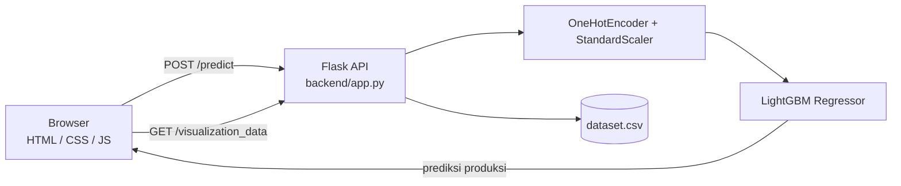

# Prediksi Produksi Padi di Sumatera (LightGBM)


Aplikasi web untuk memprediksi produksi padi per provinsi di Pulau Sumatera berdasarkan luas panen dan kondisi iklim. Model regresi **LightGBM** dilayani lewat backend Flask, dengan antarmuka HTML/CSS/JavaScript.

## Hasil

| Metrik | Nilai |
|--------|-------|
| R² | **0,8692** |

Model dikembangkan sebagai bagian dari karya tulis ilmiah.

## Fitur

- Form prediksi produksi padi dari enam masukan: provinsi, tahun, luas panen (ha), curah hujan (mm), kelembapan (%), dan suhu rata-rata (°C).
- Visualisasi data historis: rata-rata produksi per provinsi, rata-rata produksi per tahun, dan matriks korelasi antar variabel.
- Pra-pemrosesan konsisten dengan data latih: one-hot encoding untuk provinsi dan standardisasi fitur serta target.

## Data

`backend/dataset.csv` berisi 224 baris data tahunan 1993–2020 untuk delapan provinsi: Aceh, Sumatera Utara, Sumatera Barat, Riau, Jambi, Sumatera Selatan, Bengkulu, dan Lampung.

| Kolom | Keterangan |
|-------|------------|
| `Provinsi` | Nama provinsi |
| `Tahun` | Tahun pengamatan |
| `Produksi` | Produksi padi (target) |
| `Luas Panen` | Luas panen (ha) |
| `Curah hujan` | Curah hujan (mm) |
| `Kelembapan` | Kelembapan (%) |
| `Suhu rata-rata` | Suhu rata-rata (°C) |

## Arsitektur



## Struktur proyek

```
.
├── backend/
│   ├── app.py                # Flask API dan penyaji frontend
│   ├── dataset.csv           # Data historis produksi padi
│   ├── best_model.pkl        # Model LightGBM terlatih
│   ├── scaler_X.pkl          # Scaler fitur
│   ├── scaler_y.pkl          # Scaler target
│   ├── ohe_encoder.pkl       # One-hot encoder provinsi
│   ├── feature_names.pkl     # Urutan fitur saat pelatihan
│   └── requirements.txt
├── frontend/
│   ├── index.html
│   ├── style.css
│   └── script.js
├── LICENSE
└── README.md
```

## Menjalankan secara lokal

Prasyarat: Python 3.10 dan pip.

```bash
git clone https://github.com/fawzulmumin/BMGTSH_PROJECT.git
cd BMGTSH_PROJECT/backend

python -m venv .venv
source .venv/bin/activate        # Windows: .venv\Scripts\activate
pip install -r requirements.txt

python app.py
```

Buka <http://127.0.0.1:5000/> di browser.

> Jalankan `python app.py` dari dalam folder `backend/`, karena `dataset.csv` dan file model dibaca dari direktori kerja tersebut.

## Cara penggunaan

1. Pilih provinsi dan isi tahun, luas panen, curah hujan, kelembapan, dan suhu rata-rata.
2. Klik **Prediksi** untuk melihat estimasi produksi padi.
3. Lihat grafik di halaman untuk membandingkan dengan data historis.

## API

| Method | Endpoint | Keterangan |
|--------|----------|------------|
| `POST` | `/predict` | Menerima JSON `Provinsi`, `Tahun`, `Luas_Panen`, `Curah_hujan`, `Kelembapan`, `Suhu_rata_rata`; mengembalikan `prediction`. |
| `GET` | `/visualization_data` | Data grafik batang, grafik garis, dan matriks korelasi. |

Contoh permintaan:

```bash
curl -X POST http://127.0.0.1:5000/predict \
  -H "Content-Type: application/json" \
  -d '{"Provinsi":"Aceh","Tahun":2020,"Luas_Panen":300000,"Curah_hujan":1800,"Kelembapan":82,"Suhu_rata_rata":27}'
```

## Teknologi

Python, Flask, Flask-CORS, LightGBM, scikit-learn, pandas, HTML, CSS, JavaScript.

## Lisensi

Dirilis di bawah lisensi MIT. Lihat berkas [LICENSE](LICENSE).
